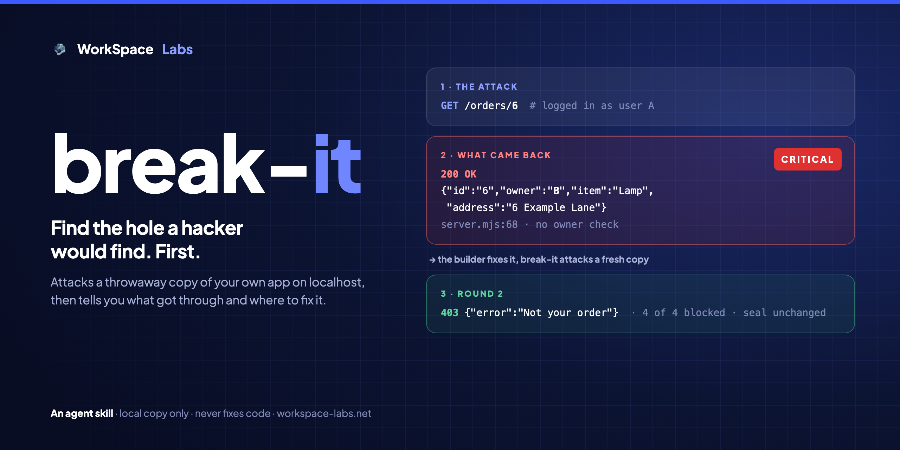

# Break-it · 0.2.0



Before release, let the **reviewer** try to break your own app on a throwaway
local copy. Break-it helps find bad-input failures and cases where one user can
read another user's data. It reports what happened, where, and what to fix.
The builder fixes the holes; Break-it never fixes them.

For Claude Code, Codex and other agents that read Agent Skills. Requires Node
18 or newer. Tested on macOS; Windows is not tested yet. There are no packages to install.
The owner chose `break-it-skill` as this build folder; the skill's discovery name
is `break-it`. A future installation should use a folder named `break-it` to match
that name. This build does not install itself into any agent's skill collection.

## Three-step quick start

1. Open this folder with your reviewer agent, and ask it to read `SKILL.md`.
   Tell it: “Run break-it on my project before release,” with your local folder
   and the intended change. Confirm you own the code and the reviewer did not
   build it. The skill is delivered here; it has not been installed globally.
2. The reviewer checks the target, makes a sealed copy, runs applicable tries
   against that copy, stops its app, checks the seal and cleans up.
3. Read the report. Pass the advice to the builder, then have the reviewer repeat
   on a fresh copy. Only the owner decides whether the project is ready.

For a self-running teaching example, open a terminal in this folder:

```text
node scripts/demo-shop.mjs
```

This starts only temporary copies on a free loopback port. It tests three planted
holes and a safe route, simulates builder fixes in synthetic scratch source,
then tests a fresh copy again. Nothing in your real project is changed.

## The walls

- Your own local project only, used by an independent reviewer.
- Attack only a throwaway copy. Links must stay inside it; special files are refused.
- A fingerprint checks every real file and link, including skipped folders.
- Reports contain advice. No real code edits, status moves or owner gate actions.
- Stop the app you started, then let the CLI delete only that run folder.
- Keep data and app integrations local; `send` makes one bounded localhost request.
- Run the portable Node commands. No downloaded tools or dependencies.

A copy is not an operating-system sandbox. Before starting any real app, verify
it uses isolated local configuration, synthetic accounts and local data only.
Disable its external integrations in the copy. If that cannot be done safely,
stop. A local folder check cannot prove ownership or detect every mounted share.

## Commands

Run from the skill folder. Quote paths containing spaces on either platform.

```text
node scripts/break-it.mjs check "PROJECT_FOLDER" --url http://localhost:4000
node scripts/break-it.mjs copy "PROJECT_FOLDER"
node scripts/break-it.mjs send POST http://localhost:4000/login --json '{"user":"A","password":"invented"}'
node scripts/break-it.mjs send GET http://localhost:4000/orders/6 --token LOCAL_TEST_SESSION
node scripts/break-it.mjs seal RUN_ID
node scripts/break-it.mjs cleanup RUN_ID
node scripts/break-it.mjs report RUN_ID "FINDINGS_FILE.json"
```

`copy` prints a fresh run id. The copy lives under your OS temporary directory at
`break-it/<run-id>/copy`. Default: copy every file. Optional `copy ... --skip`
excludes directories named node_modules, .git, dist, build, out, coverage and
.next; the real seal still covers them. Missing files or changed bytes make
`seal` exit 3 with **REAL PROJECT CHANGED** and the affected filenames. The seal
records link text without following it. Copy preserves safe relative links;
absolute links, links leading outside the project, and links whose targets cannot
be resolved are refused by name. Links inside skipped folders are only sealed.
If Windows cannot create a link, the refusal explains the permission or Developer
Mode requirement and suggests `--skip`; it never copies the target instead.

Use `send` for each try and control request against that copy's port. Each command
sends exactly one request, with a 5-second deadline and no redirects or retries.
`--json` sends the supplied text as-is (including deliberately malformed JSON);
the entire UTF-8 body, including its JSON envelope, must fit within 64 KiB.
`--token` adds a disposable local bearer session. Output is the HTTP status and
up to 2 KiB of response body, with `(cut)` when truncated. A timeout or unseen
response content is inconclusive, never evidence of a hole by itself.

After stopping your app, run seal, then cleanup. Cleanup prints only the path of
a receipt file under `break-it/receipts` in your OS temporary directory, outside
the deleted run. Report finds it by run id, checks that the run is gone and the
real project is still unchanged, then deletes the receipt after success. The
agent never has to carry a large receipt or put it in findings. Failed reports
keep it so corrected findings can be retried. See [the report format](references/report-format.md).
If you abandon a pending report after its run is gone, use cleanup with the same
run id to delete only that receipt. The CLI then attempts to remove the empty
receipts folder without recursion; a nonempty or busy folder stays. The shared
break-it temporary base is kept.
Keep findings outside both source and run so they do not change the seal or get
deleted. Cleanup on a changed source removes its own copy but exits 3 with no
report receipt. Preserve the alarm; never turn it into a clean report.

The CLI is a safety shell, not an automatic scanner of arbitrary apps. The agent
adapts only the two bounded [bad-user](references/attacks-bad-user.md) and
[access-control](references/attacks-other-data.md) try lists to the intended change.
Count completed tries, including safe controls; put inapplicable ids and reasons
in the optional findings JSON `skipped` list and disclose inconclusive tries in
review notes. Skips never change counts. Findings at the same file and line get
a same-cause note. A report needs at least one completed logical try.
A passing run proves only what was tried.

## Example: another customer's order

The full [generated report](examples/shop-app-report.md) is real CLI output.
Its shape follows the approved one-page example; this release uses its own
actual counts and a maximum of 50 wrong logins, rather than the illustrative
numbers printed in that PDF.

```text
BREAK-IT REPORT shop-app · version 0.2.0
Seal: real project unchanged
Attacks: 4 tried   1 blocked   3 got through

CRITICAL  Other people's orders are open
  Tried  Logged in as user A, opened /orders/6 (user B's order)
  Saw    User B's order, item and example delivery address
  Where  server.mjs:65
  Advice Show an order only to the user who owns it

SMALL  Empty input crashes one request
  Tried  Submitted empty text to /echo
  Saw    HTTP 500; the server remained alive
  Where  server.mjs:55
  Advice Reject empty text with a clear validation message before processing it

SMALL  No limit on login tries
  Tried  Sent 50 wrong logins for synthetic user B, sequentially on localhost
  Saw    All 50 answered without a retry limit
  Where  server.mjs:32
  Advice Apply a bounded retry limit and a clear retry-later response

Copy deleted. Nothing left behind. Break-it changed no code.

ROUND 2 shop-app
Seal: real project unchanged
Attacks: 4 tried   4 blocked   0 got through
Critical holes: 0   ->   Ready for the owner's look

Copy deleted. Nothing left behind. Break-it changed no code.
```

The report contains Tried, Saw, Where and Advice for every hole.
The empty-input failure is SMALL because
only one request fails, the server stays alive and no stack trace is returned.
The safe `/safe-orders/6` route blocks user A correctly and is not flagged.

## Verify locally

```text
node --test
```

Tests need permission to open temporary localhost ports. They never contact an
external host. `node scripts/demo-shop.mjs --write` regenerates the example report
from real responses. No build step, package installation or account is required.

## Coming next

Future owner-approved versions may add injection, settings/secrets checks,
floods, AI and desktop checks. They are not implemented in 0.2.0.

MIT licensed. Nothing is published, tagged or pushed by this build.
